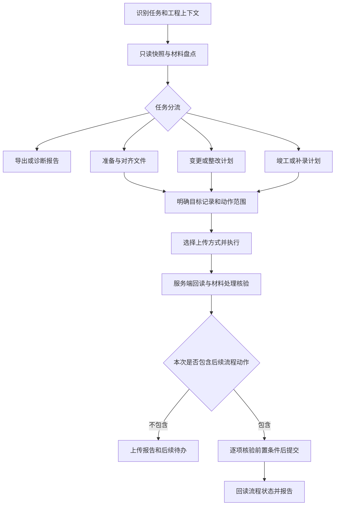

# blueprint-batch-upload 技能完善设计

日期：2026-10-09｜版本：设计稿 v0.1｜状态：供评审，尚未实施

需求见 [requirements.md](requirements.md)，业务依据和资料差异见 [sources.md](sources.md)，后续工作见 [tasks.md](tasks.md) 和 [plan.md](plan.md)。本文中的新增文件、命令、字段和模块均为拟议设计，不能作为当前已实现能力使用。

## 1. 设计结论

保留 `blueprint-batch-upload` 名称，以一个技能入口承接不同图纸任务，内部采用“业务分流 + 公共材料处理 + 页面适配 + 执行核验”的结构。现有路径 A/B 保留为上传方式，放在业务分流之后选择。先解决上传可靠性及一般/重大变更、竣工的差异，再扩展初次上传、整改和补录。

不立即拆成多个独立技能。当前这些任务共享工程上下文、图纸身份、材料匹配、上传与回读；拆开容易重复实现并丢失上下文。将不同业务说明放入按需读取的 references，未来只有在 BIM 或 CAD 工具工作流形成独立能力时再单独拆分。

最重要的变化是：不再让“文件上传成功”承担业务完成的含义。每次任务都明确要交付到哪一步，并分别记录材料状态与业务状态。

## 2. 任务入口与路由

### 2.1 最小上下文

先从用户原话、已有任务清单和页面读取信息，缺什么补什么，不要求每次填完整问卷。

| 字段 | 作用 | 缺失时 |
|---|---|---|
| 任务及范围 | 导出、准备、上传、变更申请、整改、竣工、补录、排障 | 可只读盘点，依赖任务类型的动作暂停 |
| 工程及业务记录 | 站点、WID、业务记录/WHID；页面可读名称用于复核 | 禁止向不明工程写入 |
| 角色与单位 | 建设、设计等角色，OrgId 及实际设计单位 | 只执行当前角色有权限且用户已授权的动作 |
| 单体、专业、阶段 | 使用稳定 ID（若存在）和显示名称；阶段含当前 workstatus | “所有”可用于只读汇总，上传拆到具体范围 |
| 文件及材料性质 | 图纸、变更说明、联系单、专篇、模型；原件目录 | 无文件可做流程分析与差异报告 |
| 变更/补录上下文 | 变更单 ID、类型、关联、历史项目适用条件 | 只在对应任务要求；不能由文件夹名称猜测 |
| 本次结束点 | 仅准备、仅上传、完成上传、完成回复等 | 从明确请求推断；跨入未授权外部动作前再补齐授权 |

变更类型未确定时输出“疑似重大/信息不足/已有责任主体判定”，附 S2 条款及材料依据。不提供“未命中关键词所以一般变更”的规则。资料中的时间节点和特殊工程条件作为待核实字段，不硬编码成全部工程共用的结论。

### 2.2 不同任务的操作设计

| 模式 | 输入与前置 | 主要动作 | 本模式完成条件 |
|---|---|---|---|
| 只读盘点/排障 | 已登录页面或离线快照 | 导出目录、版本、变更关联；对账、分类阻塞 | 快照范围完整，差异和证据明确；不发写请求 |
| 文件准备/对齐 | 本地目录、可选系统快照 | 文件分型、CAD/PDF 配对、映射、暂存副本、ZwPack 打包验证 | 可上传集合及待处理项清楚；不自动上传 |
| 已有图纸新版 | 已有 BPID、当前阶段、目标版本基线 | 按计划上传到唯一记录并核验 | 本次版本/处理结果得到回读确认；后续提交另算 |
| 初次上传/新增 | 工程/单体/专业已建立，明确新增意图 | 验证没有对应记录，再走新增入口并保存新 BPID | 新目录及首版正确；不把未匹配文件擅自当新增 |
| 一般变更：记录类 | 已确认类型、原因/内容、记录单/联系单/标注材料、精确关联 | 发起或进入变更单；按允许路径上传材料及关联，可无新版图纸 | 材料及关联正确；若授权办结，回读“已完成变更” |
| 一般变更：图纸类 | 同上，加实际变化图纸；确认上传责任单位 | 更新关联图纸或新增文件、说明；不进入重大审查路线 | 文件核验完成；办结状态单独验证 |
| 重大变更 | 已确认分类、申请及说明、重绘 CAD+PDF/PACK、原审查机构信息 | 建设单位申请→设计单位上传→提交进入审查；有意见再整改回复 | 当前委托节点完成；“待审查”不等于“已完成变更” |
| 整改/意见回复 | 意见单及审查轮次、对应图纸和回复文本 | 建立意见到文件关系，上传整改版、准备或提交回复 | 图纸核验与回复状态分别确认；新的意见另开轮次 |
| 常规竣工 | 历史变更记录、当前批准图、竣工成果、上传责任单位 | 区分未变更沿用与已变更重绘，核对关联与缺项后上传 | 上传结果明确；四方确认/承诺书/图纸码/用章/编制状态逐项列出 |
| 历史整套竣工 | 项目适用条件、完整图纸目录和历史变更材料 | 先核对历史记录，再按完整集合补传 | 整套目录对账通过，不只检查本次目录里的文件 |
| 历史工程/缺专业补录 | 是否已有工程、专业和单体；缺失原因 | 区分补录工程、补专业/专项与正常上传；规划新增项 | 资料补录达到约定节点；不宣称完成技术审查 |
| 系统元数据更正 | 原字段、拟改字段、稳定目标 ID、理由 | 独立更正计划及逐项回读 | 系统字段更正核对；不由本地文件改名隐式触发 |

BIM/GDB 先做专项识别、材料盘点及后续要求提示。没有当前模型接口、格式与处理结果证据前，不宣称 GDB 端到端自动上传已经支持。

### 2.3 业务与动作关系



## 3. 技能文件与模块组织

下面是分阶段达到的目标结构，不在本轮创建占位文件。只有对应能力实施时才新增相关资源。

```text
blueprint-batch-upload/
  SKILL.md                      短入口：任务识别、范围、路由、共有约束
  reference.md                  迁移期保留，后续改为索引以兼容原有引用
  references/
    workflow-routing.md         角色、阶段、材料、完成条件矩阵
    prepare-files.md            配对、映射、暂存、ZwPack 与 PDF 例外
    upload.md                   新增/新版、原生方式/精确上传、结果核验
    change.md                   一般/重大变更、关联、整改回复
    completion.md               竣工、历史整套、缺专业与补录
    diagnostics.md              BGID、解压、权限、未知状态诊断
    jgtgl-adapter.md             已验证页面契约及兼容性记录
  scripts/
    cors_server.py              收敛为指定暂存集合的只读服务
    receive_server.py           参数化、限定目录的证据接收服务
    prepare.py                  本地扫描、映射、暂存和报告
    reconcile.py                快照/清单/执行结果对账
    browser/
      collect.js                页面上下文、目录及版本采集
      upload.js                 上传适配及分段调度
      verify.js                 本次操作的回读核验
  tests/fixtures/               脱敏样本，仅在实现与验证阶段建立
  docs/                         开发文档，不作为每次技能必读材料
  runs/                         运行快照/暂存/日志，Git 忽略
```

`SKILL.md` 不堆放完整脚本和所有历史案例。先读取对应业务 reference，再按需要读取上传和页面契约。保留可证实的特殊行为，删除具体工程张数、固定耗时/token 估计等不应指导所有任务的结论。

第一阶段不用数据库、后台常驻服务或另建网页。采用本地 JSON/JSONL、Markdown/CSV 报告和浏览器现有会话足以解决当前问题。两个本地服务只有在浏览器工具无法直接处理文件或可靠导出时才启动。

## 4. 数据与证据设计

### 4.1 基本记录

| 对象 | 必要字段 | 用途 |
|---|---|---|
| `TaskContext` | runId、站点、WID、WHID/业务记录、OrgId、角色、单体/专业、阶段、模式、授权动作、采集时间 | 约束运行范围；重入先比对 |
| `BlueprintSnapshot` | BPID、原始图号/图名、所属上下文、BGID 当前值、版本集合、原始响应引用、完整性状态 | 不依赖 DOM 顺序或图号唯一性 |
| `VersionSnapshot` | VSID、BPID、version、status、资源地址/标识、size、可得的处理状态与时间 | 比较本次操作前后；无字段时保留 unknown |
| `ChangeRecord` | 变更单 ID、类型、说明材料、关联 BPID、上传责任单位、流程状态、历史来源 | 与图纸当前 BGID 分开保存 |
| `LocalArtifact` | 原始路径、文件类型、大小、SHA-256、解析的图号/图名、配对文件、暂存路径、验证结果 | 保留原件身份与内容追溯 |
| `PlanItem` | itemId、动作、目标 BPID 或新增标识、候选与匹配理由、预期阶段、beforeVersion、文件哈希、执行方式、复核记录 | 可评审、可恢复的唯一执行输入 |
| `ExecutionEvent` | runId/itemId、时间、尝试号、状态、请求关联、实际 VSID、错误、证据引用 | 追加写入，不能只放 window |

`WHID` 等接口字段的业务含义必须通过实际页面核实，不预设它一定就是单体 ID。内部单体字段可先用独立名称，保存与原始字段的映射。所有 ID 原值保存为字符串；空值不等于 0。服务器字段与内部字段不必同名。

计划的幂等识别键包含站点、工程、单位、单体、专业、阶段、动作、BPID/新增标识和文件 SHA-256。它用于本地重复检测，不能保证服务器“恰好执行一次”；响应丢失必须回读核查。

### 4.2 快照完整性

采集须覆盖约定单体、单位和专业，记录请求参数、分页、总数与回读时间。优先取当前页面已发出的原始响应；只有 DOM 时标注 BGID/完整版本可能不可得，不补猜字段。捕获到跨专业晚到响应时，以请求参数绑定上下文，不用可变的 `curProf` 标记。

页面“行数连续两次不变”只作辅助信号，不能证明正确专业已加载或分页完整。需同时核对选中上下文、请求完成及响应中的记录所属信息。版本列表以 VSID/服务端语义核对，不假定 DOM 最后一个永远是最新版本。

### 4.3 每次运行的交付

建议按 `runs/<runId>/` 保存 `context.json`、`snapshot-before.json`、`plan.json`、`events.jsonl`、`snapshot-after.json`、`report.md` 和可选 CSV；`staging/` 存暂存副本。JSON 为主记录，CSV 面向核查，可用 UTF-8 BOM 和标准字段引号规则。

运行报告必须区分：文件核验成功数、失败数、待核查数、跳过数、未执行数；业务流程当前状态；阻塞原因；下一步责任方。计数之和等于计划项总数，且每项均可追到目标、文件和结果证据。

## 5. 文件准备与匹配

### 5.1 材料类型

- 普通图纸：检查 CAD/PDF 成对、同名、非空与重复，调用已有 ZwPack 生成或验证 PACK。内容一致、坐标及 T3 有效性不能靠扩展名判断，需工具结果或负责人核验记录。
- 无 CAD 的专篇、报告、目录等：按 B07 检查是否属于允许的材料类别并使用实际 PDF 上传分支，不为绕过限制给普通图纸加关键词。
- 变更说明、联系单：独立材料身份与关联，不能仅因其文件是 PDF 就当作替换某张图的新版。
- 模型：保留原后缀、真实 MIME/内容类型和专项入口，不强制改成 PACK。

优先使用目录中已有 ZwPack；其 CLI 能力尚未确认，默认按已知 GUI 操作指导打包和验证。如人工一次选目录最省事，给出明确输入/输出目录即可，不逆向仿制格式。已有有效 PACK 可直接验证后进入计划。

### 5.2 匹配顺序

1. 先限定工程、设计单位、单体、专业及阶段。用户提供可靠 BPID 映射时优先核对它。
2. 在范围内对原始图号精确匹配，并核对图名、目录/图签证据。去空白、全半角等规范化仅用于候选检索，保留原始值；若规范化后冲突，不自动接受。
3. 图名精确或相似匹配只生成候选。原来的 0.75 是历史检索阈值，可配置且必须展示算法/分数，不作为自动确认的充分条件。
4. 同图号多候选、跨位置近似名称、名称内下划线、同一 BPID 对应多个本地文件时，形成冲突项，禁止自动择首项。
5. 原系统录错图号时，只有证据证明文件确属该 BPID，才在暂存副本使用系统所需命名；保留异常说明。若需要改系统字段，转 R12。
6. 未匹配项明确标为“缺文件”“无系统记录”“可能新增”或“范围不全”。只有明确新增意图才能建立新目录。

默认复制到暂存目录并记录内容哈希，不直接改原件。若用户明确要求原地改名，先生成可逆映射、检查重名/环形交换/覆盖冲突，再用分步临时命名完成；恢复也必须检查目标是否被后续修改。

## 6. 上传方式与页面适配

### 6.1 方式选择

| 条件 | 优先方式 | 回退 |
|---|---|---|
| 工具能可靠设置原生文件输入，页面批量匹配已验证 | 使用原生页面上传流程 | 人工一次多选；或精确目标上传 |
| 同范围大量文件、完整命名对应、没有已知解析问题 | 页面原生批量多选 | 失败/冲突项单独处理 |
| 含点等历史解析问题、同图号冲突或必须明确 BPID | 经适配验证的精确目标上传 | 单条原生上传或人工处理 |
| 当前页面内部函数/阶段未知，或工具不可调用 | 只读计划与具体人工操作说明 | 补齐页面证据后再适配 |

不再使用“系统文件选择框永远不能自动化”的绝对结论。路径由本次工具能力决定；人工多选仍是合法且常常最直接的路径。自动化方式必须保留页面的文件类型、签章、权限和阶段检查。

### 6.2 页面契约

实施前采集并记录：站点与页面特征、日期、支持的角色/阶段、列表和版本响应结构、原生上传校验、`uploadPDF`/`cos`/`wstatus` 等依赖、当前按钮语义及完成入口。未验证的页面不复用竣工页补丁。

如确实重现 `link.closest(...).find(...)` 问题，优先最小修复；记录被替换函数及可恢复引用，适配必须证明没有丢失其他业务校验。不能只复制历史整函数覆盖当前实现。直接调用内部保存方法前，要确认原生入口的所有前置步骤仍被执行，尤其 PDF 校验与已通过版本处理。

已知接口名仅作为探测线索：`read_blueprint_and_version`、`upload.do`、`blueprintVersion_add_jgt`、`unpack.do`。一般变更、新增、整改、完成回复等接口尚未采集，不在设计中编造其参数或假设共享同一地址。

### 6.3 本地服务

仅在需要时启动，绑定 127.0.0.1。文件服务只提供本次计划列出的暂存文件，不暴露整个业务资料盘。接收服务通过参数指定运行目录和端口，使用唯一事件名与追加记录，不覆盖前一专业/批次证据。

当前 `receive_server.py` 的请求路径经 unquote 后可能含 Windows 分隔符或盘符，需要改为仅允许固定安全文件标识；拒绝绝对路径、父级跳转和超出运行目录的解析结果。两个服务增加实际站点 Origin 限制及运行令牌、接收大小限制、JSON 验证；处理符号链接/目录联接后的最终路径边界。任务结束停止服务，令牌不入日志。遇浏览器跨域或本地网络限制时使用原生文件工具/下载，不把关闭浏览器安全设置当默认解决方案。

## 7. 执行、核验与恢复

### 7.1 两套状态

文件项状态拟为：

```text
planned → prechecked → uploading → stored → version_saved
        → processing → verified
```

PDF 等不需要 PACK 解压的材料可跳过 `processing`，但仍检查其实际前置及后处理要求。任一状态可进入 `failed`、`unknown` 或 `blocked`；未执行项保留 `planned`，明确跳过项用 `skipped`。`verified` 必须与本次 VSID/资源及预期阶段绑定。

业务状态单独保存服务器原始值及归类，例如“待上传、待审查、待整改、已完成变更、待各方确认、完成编制”。没有读到流程状态就写“未核实”，不用文件状态推导。

### 7.2 分段编排

保留浏览器内顺序队列，但批次大小与文件体积、页面能力、服务器表现有关，15–20 只作初始经验。浏览器任务快速返回句柄，由短轮询获取进度；每个关键状态落地本地事件日志，不要求一个 evaluate 挂起数分钟。

每批绑定不可变上下文和运行锁；禁止另一个批次覆盖同一 `window.__batchStatus`。上下文改变、登录失效、目标不唯一、证据持久化失败或出现结果未知时暂停该队列。停止意味着不再派发新任务，不能假设取消了已发送的服务器请求。

### 7.3 成功判断

一项上传成功须同时满足：

1. 文件存储请求及业务响应成功，资源标识有效。
2. 版本保存响应成功且回读得到预期 BPID 对应的实际 VSID/版本；阶段正确，没有新增错行。
3. PACK 解压或其他后处理明确完成，并能按系统支持的方式验证关联 PDF 等输出；仅 200 或页面“已上传”不足。
4. 文件名、大小及可得的内容证据与计划一致。远端可取哈希时对比；无法取哈希时标明证据强度，不伪称字节一致。
5. 计划内全量对账。内容预览抽查可补充，但不能代替每一项记录核验。

同阶段重传可能替换当前版本，不能要求版本数必然加一。保存前后快照，以返回标识和回读变化判定。

### 7.4 失败、未知与重试

| 现场结果 | 分类 | 下一步 |
|---|---|---|
| 本地文件不存在，尚未发上传 | failed | 修复材料后可按原计划重试 |
| 明确业务拒绝且确认未生成版本 | failed | 按原因纠正；不循环撞接口 |
| 超时、断网、页面刷新，可能已经保存 | unknown | 先按 BPID、前后版本、资源及文件证据回读，不立即重传 |
| 版本已保存，解压失败 | failed/processing | 优先查现有版本处理情况；是否支持重解压须验证，不能盲目再建版本 |
| 回读确认本次上传已成功但本地未记成功 | verified（恢复） | 补写证据，跳过再次上传 |
| 目标阶段、关联或记录变化 | blocked | 重新规划相关项；保留原执行记录 |

默认每次只自动恢复可证明没有产生写副作用的前置失败；外部写入失败先核对再决定重试。重复失败原因未变化就停止该项，不无限重试。所有超时项必须写入状态，杜绝旧循环中“跑完却少结果”。

## 8. 变更关联与竣工诊断

一般变更的核心是记录与准确关联，不能为省事全选本专业。变更计划分别列出“关联已有图纸”“上传新版”“新增图纸”“说明材料”四类动作，并展示集合差异。关联数与新版图数量不同可能是合法记录类变更，不能要求强制相等。

BGID 排障输出三层证据：当前目录关联、历史变更单及材料、当前版本/竣工成果。对每张图归为：

- 有真实变更且缺竣工成果：补齐对应重绘成果。
- 有变更记录但无新版图：核实记录内容及最终竣工要求，不能判为误圈。
- 疑似关联错误：形成 BPID、BGID、材料和判断依据清单，交责任单位/系统管理方核实。
- 缺少证据：保持待核查。

不提供直接清 BGID 的自动修复动作。服务端阻塞条件与资料业务规则分别呈现；即使“清字段”能消除报错，也不能证明关联应被清除。将通过版重新上传为竣工版，仅在确认实际内容代表竣工状态、有对应业务依据且本次明确要求时才进入单独计划。

“完成上传”前先确认文件项核验、关联、材料和阶段前置。原 `checkCanSealJGT` 与 `blueprint_uploadComplete_jgt` 链路只适用于已验证页面，不能推广到所有流程；前一接口是否纯校验也需核实。最终报告列明完成的是上传、变更办结还是竣工编制。

## 9. 授权与操作范围

用户明确授权的上传或流程动作可以持续执行，不重复逐文件询问。只读分析、离线计划、暂存副本和报告可先完成。用户只要求上传时，默认不扩展到发起变更、修改系统图号、发送确认通知、各方确认、签章、提交审查或撤销编制；需要这些动作时先把材料和影响整理成可审核结果，再补齐缺失指令。

跨角色动作须使用相应责任方的实际会话和权限。技能可以准备回复或承诺书材料，不能把自身操作当作相关人员的专业确认。该范围设计来自真实业务分工及动作副作用，不给普通只读任务增加额外审批流程。

## 10. 验证与发布设计

先验证离线映射和恢复逻辑，再用脱敏页面样本验证适配，最后在获准的测试工程进行最小场景验证。具体用例见 [tasks.md](tasks.md)。没有测试工程时仍可交付材料准备、计划和诊断能力，把未验证写操作标为不可自动执行。

首个实现版本应优先满足：完整上下文、唯一目标、原件保留、真实文件类型、解压终态、持久化日志、未知结果先回读，以及一般/重大/竣工正确路由。初次新增和历史补录自动化在获得对应页面契约后再开启。

迁移时先记录现有四个文件的基线，再分步抽出 references 与浏览器脚本，检查原相对引用，保留必要的兼容入口。不要同时重写所有业务、匹配和上传代码。每阶段同步更新需求、设计、任务、计划和验证结论。

## 11. 待实施时核实的事项

| 问题 | 已知事实 | 不依赖答案即可做的工作 | 开启相关自动化的条件 |
|---|---|---|---|
| 当前系统与工具能力 | 本轮未连接在线页面 | 整理路由、离线预检、数据结构 | 页面、角色、输入工具及响应契约验证 |
| 批量文件名解析规则 | 手册与历史描述不完全一致 | 完整命名计划和 BPID 目标映射 | 获准样例验证，含点/冲突另行验证 |
| 新增与各阶段上传接口 | 仅掌握历史竣工链路 | 分模式操作说明 | 对应页面取证与验证，不能照搬参数 |
| ZwPack 自动化方式 | 本地已有可执行文件，手册描述 GUI | 配对清单、打包目录、人工操作步骤 | 了解实际能力后决定是否增加脚本适配 |
| 业务规则时效及项目适用性 | 所给资料主要记录 2023 年制度 | 明确资料来源与条件字段 | 具体项目执行前核实官方现行依据和责任方结论 |
| BGID 历史关系与校验条件 | 只有历史单项目记录 | 生成疑点清单，不做归因跳跃 | 当前快照、变更单材料与失败证据闭合 |

这些事项不阻止本轮设计交付，也不意味着需要现在向用户逐项提问；应在实施到对应能力时取得证据。
