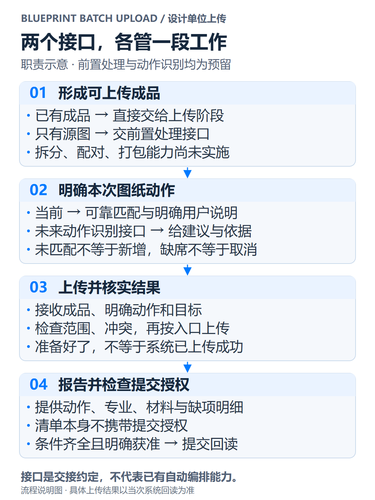

# 两个预留衔接接口

日期：2026-10-27。状态：仅记录，未实现自动调用或新的导入能力。本轮不继续扩展技能。

这里的“接口”指阶段之间交接哪些资料和结论，不是已经存在的 HTTP API。两个接口都可以先通过文件和清单交接；不要求用户安装新技能才可以上传现成成品。

## 接口 1：图纸前置处理 → 上传

**解决的问题**：用户只有 CAD 合图、未配对 PDF 或未打包文件，需要先形成可上传成品。

| 项目 | 预留约定 |
|---|---|
| 输入 | 源文件、正式图纸目录或命名规则、单体/专业归属、目标格式；可附历史上传改名映射 |
| 前置处理职责 | 图纸命名、拆分、CAD/PDF 配对、打包及必要的成品验证 |
| 交给上传的内容 | 成品实际路径、源图号/图名、归属范围、类型；可附大小/哈希、来源和未完成项 |
| 可选载体 | `prepared-manifest.json`，沿用原预留设计；本轮不承诺现有脚本可直接导入该格式 |
| 上传端职责 | 对接系统记录、必要的外层改名、上传与结果核验；不再次解析或同步更正包内内容 |
| 返回问题 | 缺成品、系统拒绝格式、PACK 解压失败等实际结果，交前置处理阶段处理所需文件 |
| 没有此接口时 | 已有成品目录即可使用上传技能；只有源图则列明缺少的成品，不冒充完成上传准备 |

详细原设计见 [准备图纸技能预留设计](prepare-blueprints-design.md)。前置阶段不代替设计人员编制取消单或专业变更内容。外层上传别名调整不应自动触发重新拆分或打包。

## 接口 2：变更动作识别 → 上传计划

**解决的问题**：用户只说“把 xx 路径下的变更上传”，未逐项说明更新、新增和取消。

| 项目 | 预留约定 |
|---|---|
| 输入 | 用户原始要求、成品外层信息、系统完整快照、历史映射；可附独立新版目录、变更说明、取消变更单和交接清单 |
| 识别阶段职责 | 综合证据形成更新/增补/取消/待核查建议，不让上传端仅凭匹配失败新增或凭本地缺文件取消 |
| 交给上传的内容 | 文件路径及范围、建议动作、已有图纸目标标识（适用时）、判断依据、对应材料、待确认问题及确认来源 |
| 目录关联 | 说明哪些目录材料覆盖哪些增补/取消目标；不能用机器账本替代正式目录 |
| 已有可接入点 | 当前计划的 `action`、`BPID`、`kind`、`directoryFor` 等字段可表达已明确的动作；未来识别结果须经适配，不能称已支持新清单直读 |
| 上传端职责 | 再核对当前系统范围、目标唯一性和冲突，执行已明确动作并回写实际结果 |
| 返回问题 | 多候选、材料缺失、目标漂移、系统拒绝、实际新建记录等 |
| 没有此接口时 | 当前可靠对应项可更新；未匹配项列为待核查；新增和取消依据用户明确说明或已明确清单处理 |

约束：

- 不读取 PACK 内部来判断动作；独立材料的读取方式后续设计。
- “未匹配”不等于新增，“本次没提供”不等于取消；相似名称只能提供候选。
- 取消必须对应原图并有取消材料；一份单涉及多图，逐目标交接和记录。
- 动作确认与“完成上传”按钮授权分开，识别结果不能代替用户的提交确认。
- 暂不确定独立技能名称、文件格式版本、置信度阈值或全自动执行策略，也不新增实现任务。

## 衔接位置

资料交接总体分为 **4 个阶段**，两个预留接口只解决各自阶段的问题：

1. **形成成品。** 有源图时由接口 1 交付拆分、配对、打包后的结果；用户已有成品就直接进入下一阶段，不强制再过前置处理。
2. **明确本次动作。** 需要从整批变更材料判断更新、增补、取消时，未来接口 2 结合系统快照给出动作、目标和依据。没有这个接口时，上传端继续使用已明确的用户说明与可靠匹配，歧义项单列。
3. **规划、执行和核验。** 上传端接收成品与已明确动作，检查当前系统范围和冲突，再上传并记录真实结果。它不会把前置阶段的“准备完成”当作系统“上传成功”。
4. **报告与提交。** 输出本次具体操作和缺项；提交条件满足后，还须有用户确认或明确授权才点击“完成上传”。两个接口提供的清单本身不携带这一授权。

图中四个阶段容器自上而下排列。先看标题可理解资料流，框内再区分当前处理方式和未来接口职责；两个接口的未实施状态直接写在图里。

此图表示职责与资料流，不表示已实现自动识别或编排。[可编辑 SVG](upload-guide/sources/09-interfaces.svg) 与 [分阶段 Mermaid 源](upload-guide/sources/09-interfaces.mmd) 可用于后续维护。
