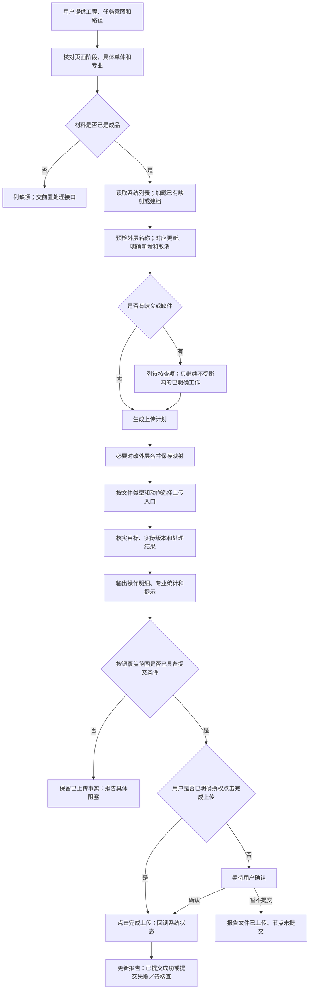
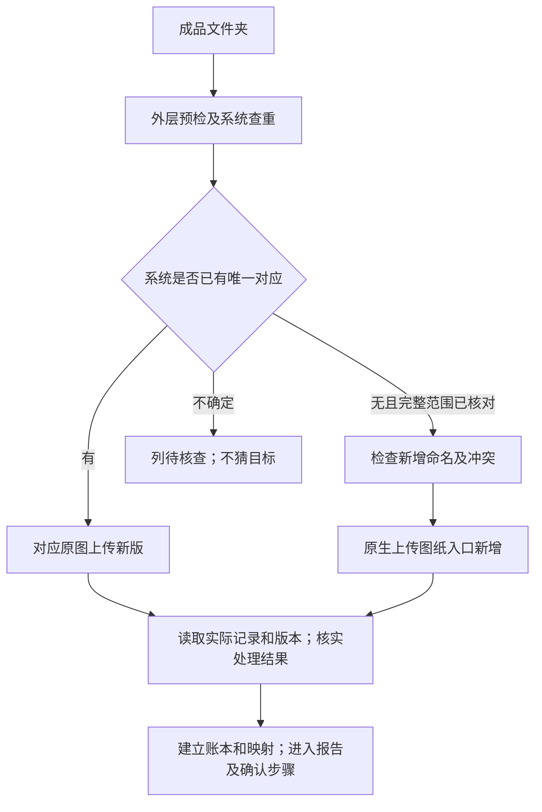
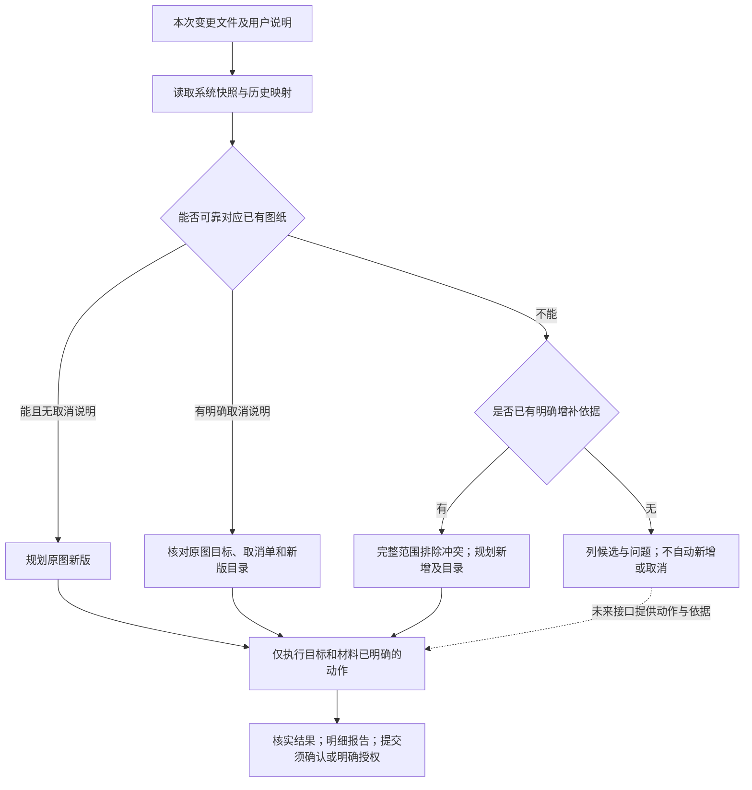
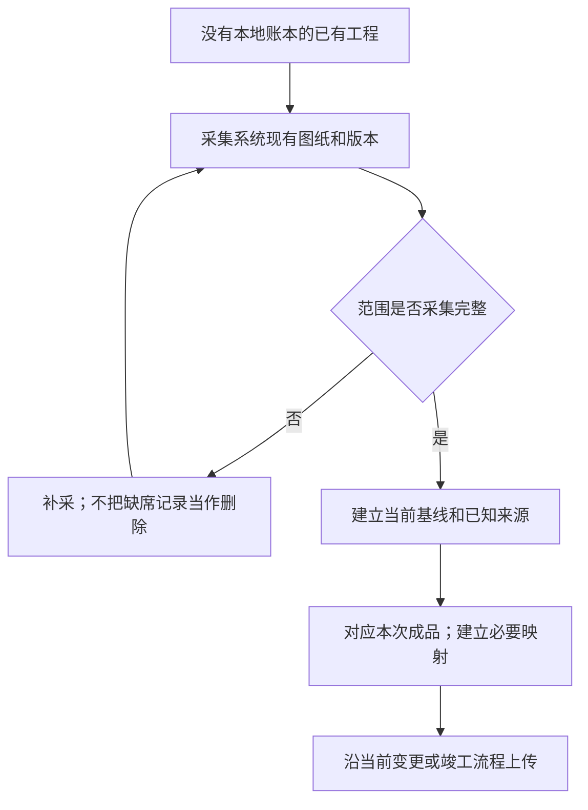
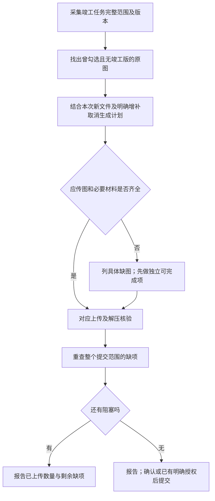
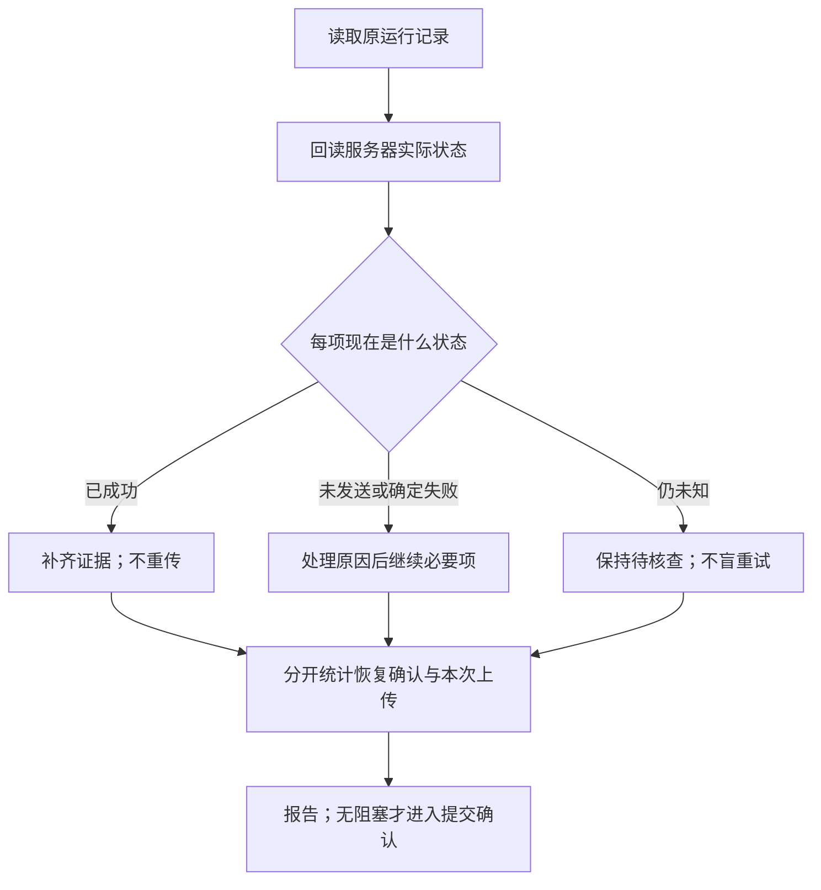
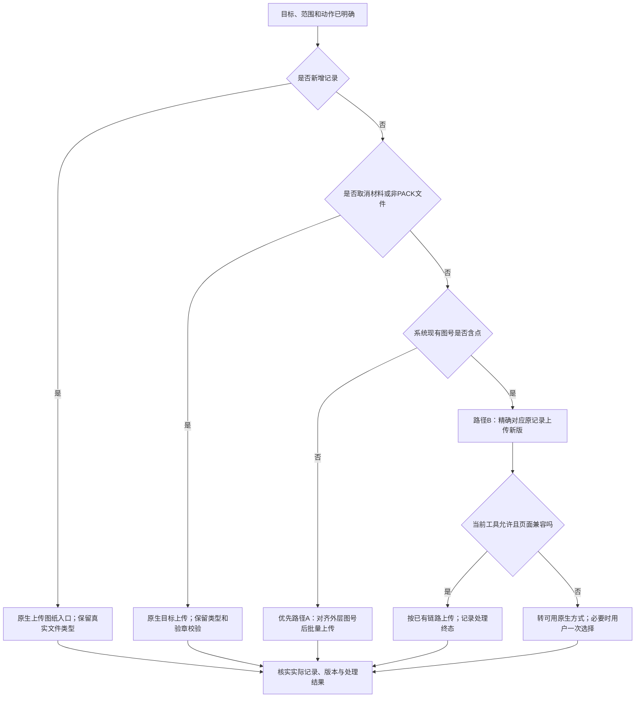

# 图纸上传技能：从一句话委托到可核对的操作报告

日期：2026-10-27｜面向设计单位｜情境介绍与后续改进依据

你提供工程和成品路径，技能负责把文件对应到正确的系统图纸，处理必要的外层改名，执行上传并核实结果，最后告诉你具体做了什么、还缺什么。

三类任务是初次上传、变更上传和竣工图上传。系统已有工程第一次交给技能接手，也能从系统当前列表建立本地账本，无需找齐全部历史文件。图纸源文件的拆分、配对和打包另属前置处理。

本介绍已随 2026-10-27 的后续实施更新：完成上传授权检查与操作报告工具已落地，流程图全部竖向并附阶段说明。下文区分三种状态：

- **当前能力**：已有操作规则、工具或已验证经验支持；实际系统成功仍以当次回读为准。
- **本轮新增实现**：显式授权记录、提交前检查、按动作与专业汇总的 JSON/Markdown 报告；均基于本地记录，不能替代真实页面操作及证据。
- **预留接口**：图纸前置处理、变更动作识别，只记录职责和交接内容。

所有情境、数字和报告均为示例，不代表真实上传结果。坑点会另标明是原技能经验、离线测试发现还是说明性示例。

## 1. 先分清“文件上传”与“完成上传”按钮

**执行规则：上传文件并核实后，先给用户操作报告；点击系统“完成上传”须由用户确认，除非用户已明确授权该按钮动作。**

| 用户怎么说 | 上传文件 | 点击“完成上传” |
|---|---|---|
| 帮我把这个工程的变更图上传到审图系统，路径在 xx | 在工程、范围和对应关系明确后执行 | 报告后询问确认 |
| 把这些图传完 | 执行文件上传 | 不把这句话扩大解释为按钮授权 |
| 上传核验无误后，直接点击“完成上传”，不用再问 | 执行 | 检查无阻塞后可直接点击，不重复询问 |
| 先传两张试试／只传建筑专业／先别提交 | 只执行限定范围 | 不结束更大范围任务；先别提交则不点击 |
| 只检查一下，别改文件 | 不上传、不改名 | 不点击 |

确认应具体，例如：“本次文件已全部核实，目录已更新，无待处理项。是否点击本工程变更任务的‘完成上传’？”先确认按钮影响范围，不能拿“建筑专业传完了”代替“整个工程可提交”。

若有缺目录、缺取消单、必传图未传或结果未知，先说明阻塞，不把“请确认”当成跳过检查的办法。授权覆盖的范围变化时，重新说明变化；原范围内已明确授权则不反复询问。

### 总体执行路径

总体分为 **5 个阶段**。这五段分别解决“操作哪里、每份文件做什么、实际做成了没有、用户如何核对、是否提交节点”。

1. **确定范围与材料。** 输入是用户的工程、路径和要求；核对当前节点、具体单体、专业及限制。没有成品就先列缺项，只有源 CAD 时交前置处理。输出是明确的任务范围，不把本地文件夹名直接当作系统单体。
2. **建立对应和计划。** 读取系统列表和历史映射，把每份成品对应为原图新版、明确新增、明确取消或待核查。缺件与歧义留在计划里，不能通过猜测消掉；只让不依赖它们的明确项继续。
3. **执行并核实文件操作。** 只在必要时改外层名，按动作与格式选择入口。每项必须核对目标、实际版本和处理结果；超时回读，失败查原因，不能用“请求发出”代替“上传成功”。
4. **形成操作报告。** 按动作和专业汇总本次事实，目录、取消材料、之前已成功项分别列明。用户可以从完整明细看到具体动了哪些记录，而不是只收到一个成功总数。
5. **判断能否提交并检查授权。** 先检查按钮覆盖的整个范围是否齐全，再判断用户是否明确授权。无授权则等待确认，有授权但有阻塞仍不能提交；点击后回读实际状态并更新报告。

确认分支已由当前技能指引和工具共同落实：记录明确授权后运行提交前检查；旧计划中的 `completeRequested=true` 本身不代表授权。本地检查只覆盖指定计划，代理仍须核对真实按钮是否覆盖更多单体或专业。

## 2. 情境一：第一次上传，交给你一个文件夹

**用户可能说**：“帮我把这个工程的图纸上传到审图系统，文件在 xx，这个项目还没上传过。”

技能先核对工程和上传范围，再检查系统是否已有部分记录。用户可能不知道同事已上传过几张，首次任务也不能不看系统就全部新建。

对真正新增的成品，检查非空、类型、图号/图名结构和重号；图号含点时可改为无冲突的上传号，保存映射。只改外层名，不读取或同步改正包内图签。已有记录则转为对应新版，避免重复建图。

首次上传的文件路径分为 **4 个阶段**：

1. **预检与查重。** 本地检查成品外层，系统检查是否已有记录。两边都要看，才能分清真正首传和中断后的继续上传。
2. **决定新增还是更新。** 唯一对应已有记录就上传新版；完整范围内没有对应、且命名无冲突才新增。无法确定的项停在核查，不给它随意分配新图号。
3. **写入系统并回读。** 新增与更新使用各自入口；回读实际图纸和版本，确认系统解析的结果与计划一致。
4. **保存交接结果。** 把系统身份和改名关系写入账本，形成报告；是否点击“完成上传”统一进入总体流程第 5 阶段。

**交付**：新增与更新明细、改名对应表、真实记录及版本、操作报告。正式目录缺失会提醒；初次预检中的缺目录提示不等于已证明系统强制拒绝，是否阻塞还须按实际节点要求判断。

**报告示例**：“成功新增 42 张图纸，其中建筑 30 张、给排水 12 张；另上传目录 2 份。外层改名 5 项，详见明细。文件核验完成，尚未点击‘完成上传’，等待你的确认。”

## 3. 情境二：把这次变更传上去，用户没有逐张分类

**用户可能说**：“帮我把这个工程的变更图上传到审图系统上，路径在 xx。”

这句话足以开始核对，不要求用户先写成技术清单。技能读取已推送给设计单位的变更任务，盘点文件，并与系统已有图纸及历史改名表对应。

**当前能直接处理**：能可靠对应原记录的更新项，以及用户或已明确清单指出的新增、取消项。**当前缺口**：不能只靠文件夹自动可靠判定全部新增和取消；自动综合独立变更材料的能力仅预留接口。

变更分类与执行分为 **4 个阶段**：

1. **补全上下文。** 从系统与历史映射取得已有图纸身份，避免只按文件名猜工程或单体。
2. **逐项判断动作。** 能可靠匹配且没有取消说明的是新版更新；明确取消需要找到原目标、取消单与目录；不能匹配时，只有明确增补依据才走新增。其他项列候选和问题。
3. **执行证据充分的部分。** 已明确目标与材料的项继续上传，待核查项不派发。图中虚线是未来接口的交接位置，不是现有自动分类器。
4. **核实与报告。** 写清各动作实际结果和未执行原因；有缺件不提交，无缺件则进入授权确认。这样用户不用预先整理技术清单，也不会因一句“上传变更”而被擅自增删图纸。

例如 15 个文件中 12 个可以明确对应，另 3 个找不到目标，技能应说明这 3 个为什么不确定，并继续不受其影响的已授权工作。不会要求用户重新确认全部 15 个，也不会把这 3 个一律新增。

**交付**：更新/新增/取消/待核查分类表、每项判断依据、对应目标与缺件。预留能力见 [接口 2](reserved-interfaces.md)。

**报告示例**：“本次成功上传 12 张图纸，均为原图新版；建筑 8 张、给排水 4 张。另 3 项未匹配，未上传，详见待核查列表。尚未点击‘完成上传’。”

## 4. 情境三：以前人工传的，第一次交给技能接手

**用户可能说**：“这个项目之前是同事上传的，我手里只有这次修改的图，路径在 xx，帮我接着传。”

技能从系统当前列表建立基线，不要求恢复历年本地文件或旧改名脚本。只记录实际观察到的身份、版本和状态；没有采全的范围标为不完整。随后匹配本次文件并沿用变更或竣工流程。

棕地接手分为 **3 个阶段**：

1. **取得可信基线。** 系统列表和版本是接手依据；分页或范围没采全就继续采集，不把没看到的记录当成不存在。
2. **连接本地成品与原记录。** 在已知范围内匹配本次文件，建立必要的别名关系。只保存能证明的当前事实，不补造历史上传记录。
3. **进入本次业务流程。** 基线建立后按当前变更或竣工任务继续。建档不是重新上传整个项目，本次没有提供的图纸保持原状。

**交付**：建档范围、系统基线、本次对应关系和上传结果。仅有本地文件而没有系统数据时，只能形成待核对清单，不能宣布系统基线建好了。

**报告示例**：“已建立建筑专业 126 条系统记录的本地基线。本次上传原图新版 3 张，其余图纸保持原状；映射已保存。尚未提交上传节点。”

## 5. 情境四：这次既改图，也增补或取消

**用户可能说**：“这批变更有新加的详图，原来的雨棚取消了，相关材料都在 xx。”

技能先确定哪些详图是新增、雨棚具体对应哪些原图。“雨棚取消”若涉及多张图，要核对范围，不能随便选一个同名记录。明确的更新对应原图；新增通过“上传图纸”建立记录；取消向原记录上传取消变更单，不删除记录。

新版正式目录要覆盖增补/取消范围。一份取消单涉及多张原图时，逐目标记录上传结果，不把它只算成“一份文件已传，所有取消均完成”。文件夹缺某张图也不等于用户取消该图。

该情境沿用变更流程，逻辑重点有 **3 个阶段**：先把“新增哪些图、取消哪些原图”明确到目标；再同时核对成品、取消单和新版目录，形成可执行与缺件两部分；最后按目标上传核实，目录没补齐时保留成功事实但不提交节点。目录更新与图纸更新是两个需要分别确认结果的动作。

**交付**：动作与目标列表、取消单关联、目录覆盖关系、成功与缺件明细。

**报告示例**：“成功上传 10 张图纸，其中替换原图 8 张、新增 2 张；建筑 7 张、给排水 3 张。另向 1 张原图上传取消变更单，取消关联已核实。提示：新版目录未更新，建议提供覆盖本次增补和取消范围的新版目录；补齐前不能完成本次上传节点。”

这里“替换原图”指对原图记录上传新版，保留历史；取消单单独计数，不混入正常图纸的新增/替换合计。

## 6. 情境五：竣工图都放这里了，为什么还交不了

**用户可能说**：“竣工图在 xx，帮我上传。上次系统一直提示还有变更图没传，我也不知道缺哪张。”

技能读取完整任务范围，找出曾被变更勾选、但没有有效竣工版的图纸。**不以是否出过变更版作为豁免条件。** 已有有效竣工版且本次没有新文件的图纸计入已满足项。

竣工上传分为 **4 个阶段**：

1. **求出系统必传集合。** 检查整个任务范围的勾选记录和竣工版本，得到“系统要求但尚未满足”的具体图纸。
2. **对照本次材料。** 把必传图与本地成品对应，再加入本次明确的新文件、增补和取消；缺件明确列出，不能删掉必传项来让计划看起来齐全。
3. **上传并重算差集。** 执行独立可完成项，核实处理结果后重新读取系统。第一次列出的缺项不能仅因发送过请求就自动划掉。
4. **决定报告和提交状态。** 仍有缺项就报告阻塞；全部满足后才进入提交授权检查。文件夹是否传完与整个系统范围是否满足是两个判断。

不能把“这个文件夹传完”写成“竣工任务完成”，也不能把本地标为取消的图直接从系统必传集合里划掉。

**报告示例**：“本次成功上传竣工新版 20 张，其中建筑 14 张、给排水 6 张。系统原有已满足项 70 张，未重复上传；仍缺 10 张曾勾选图纸的竣工成品，详见缺件列表。当前无法提交‘完成上传’。”

## 7. 情境六：昨天中断了，继续但别重传

**用户可能说**：“昨天传到一半卡住了，文件还在 xx，帮我继续，已经成功的别再传。”

技能先读取原计划、日志与服务器结果，区分本次新上传和恢复确认的旧成功。超时不等于失败；只有确定未落版本且适合重试的项才再次发送。已保存版本但解压失败时，先查处理结果，不连续制造新版本。

中断恢复分为 **4 个阶段**：

1. **还原已发生的事实。** 读取原运行记录并回读服务器，不以浏览器是否显示成功为唯一依据。
2. **按结果分流。** 已成功的补证据、不重传；未发送或确定失败的处理原因后继续；仍未知的先核查，不加入自动重试队列。
3. **继续必要操作。** 只派发需要本次执行的项，保留此前成功与本次新成功的来源，避免恢复后数量翻倍。
4. **汇总与收尾。** 报告分别说明此前确认多少、本次补传多少、累计满足多少。只有无阻塞且提交授权仍覆盖当前范围时，才可提交。

**报告示例**：“原计划 50 项，回读确认此前已成功 35 项；本次实际补传 15 项，全部已核实。没有重传那 35 项。累计 50 项已满足，尚未点击‘完成上传’，等待确认。”

## 8. 情境七：只检查、试传，或文件还没准备好

| 用户可能说 | 执行到哪里 | 报告重点 |
|---|---|---|
| 先看看 xx 这批文件能不能传，别改 | 只做预检、对应和问题清单 | 发现什么；未改名、未上传、未提交 |
| 先挑两张试传 | 只上传并核实明确的两张 | 试传结果；不能结束整批工程任务 |
| 只传建筑，给排水等我补 | 上传建筑明确项 | 分专业列结果；更大提交范围仍有缺项 |
| 图传上去就行，先别点完成 | 上传并核实 | 文件已上传；按要求不提交节点 |
| CAD 都在 xx，帮我处理一下上传 | 识别是否缺成品，列交接需求 | 前置处理尚未实施，不把源 CAD 合图当成上传包 |
| 原文件名别动 | 在需要改名时使用明确的上传副本 | 报告副本位置、映射和原文件保留情况 |

工具无法操作文件选择时，给用户准确的文件集合，必要时由用户一次多选，技能继续核验。不要求为一次简单多选重新搭上传系统。

## 9. 上传入口怎样选

入口选择分为 **3 个判断阶段和 1 个共同核验阶段**：

1. **先看是否要新建记录。** 新增图纸还没有原图目标，必须走“上传图纸”新增入口；不能因为它是 PDF 就误送到已有记录入口。
2. **已有目标再看材料类型。** 取消单和非 PACK 材料走原生目标上传，保留格式及验章处理；只有已有记录的 PACK 新版进入下一步。
3. **PACK 新版看系统图号和工具条件。** 无点优先批量；含点精确对应原记录。辅助路径不被工具允许或页面不兼容时，改用可用原生方式，必要时请用户一次选择文件。
4. **所有入口统一核实。** 不论走哪条路径，都要确认实际目标、版本与处理结果；入口选择只是执行手段，不改变成功标准。

路径 B 沿用原技能经验，只用于已有记录的 PACK 新版。它不负责创建不存在的图纸，也不能拿 PDF 改个 `.pack` 后缀混过去。

## 10. 完成报告：告诉用户到底动了哪些图

### 统一口径（已支持工具生成）

- **按动作**：本次核实成功的正常图纸 = 原图新版数 + 新增图纸数。“替换原图”保留历史，不表示物理删除。
- **按专业**：相同这批成功图纸按专业汇总，应与动作合计一致。目录、取消单和其他材料另外列明。
- **按目标计数**：同一目标的重试不重复算图纸数；一份取消单传到多个原图时分别报告材料文件数和成功关联目标数。
- **按执行批次**：本次实际上传、恢复确认之前成功、系统原有已满足分别统计，不都写成“本次成功上传”。
- **按证据来源**：新回执明确记录本次上传还是恢复确认；旧回执未记来源时，单列“来源未标记的已核实记录”，不猜测归入本次新传。
- **按结果**：成功须已核实；失败、处理中、待核查、缺件另列，不能混入成功数。
- **按提交状态**：明确写尚未提交（等待确认／按要求暂缓）、提交受阻、已提交且回读成功，或提交结果待核查。

### 示例 A：图纸传好了，但目录未更新

> 本次成功上传 6 张图纸，其中替换原图 4 张、新增 2 张；建筑专业 4 张、给排水专业 2 张。失败 0，待核查 0。另向 1 张原图上传取消变更单，原记录及历史保留。
>
> 提示：目录未更新，建议提供覆盖本次新增、取消范围的新版目录。当前文件上传结果已保存；缺目录会阻塞本次变更任务收尾，尚未点击“完成上传”。

| 专业 | 图号与图名 | 本次具体操作 | 核实结果 |
|---|---|---|---|
| 建筑 | J-01 首层平面图 | 原记录上传新版 | 成功 |
| 建筑 | J-02 二层平面图 | 原记录上传新版 | 成功 |
| 建筑 | J-03 屋面平面图 | 原记录上传新版 | 成功 |
| 建筑 | J-10 新增节点详图 | 新建图纸及首版 | 成功 |
| 给排水 | S-01 给水平面图 | 原记录上传新版 | 成功 |
| 给排水 | S-08 新增排水详图 | 新建图纸及首版 | 成功 |
| 建筑 | J-09 原雨棚详图 | 对原记录上传取消变更单 | 成功关联 1 个目标；单独计数 |

实际报告还应提供原文件、上传文件名、目标单体、实际版本及证据位置。条目多时，下方提供可打开的完整列表，正文保留关键问题。不能只给“共处理 7 个文件”让用户猜哪些是图纸、哪些是取消材料。

### 示例 B：全部核实，等用户确认

> 本次成功上传 6 张图纸：替换 4 张、新增 2 张；建筑 4 张、给排水 2 张。另更新目录 1 份，取消材料关联 1 个目标，均已核实。当前提交范围无剩余缺项。
>
> 尚未点击“完成上传”。请确认是否提交本工程本次变更上传节点；该按钮覆盖建筑、给排水两个专业。

### 示例 C：已经明确授权，且提交成功

> 已按你此前“核验后直接点击完成上传”的授权提交。系统已返回成功，并回读到本次上传节点的新状态（此处填写实际状态）。本次图纸、目录及取消材料的明细见下方。

若提交失败，则保留文件成功统计，单独写出提交错误与待办，不能将整批文件改成“未上传”，也不能写“全部完成”。

### 工具如何形成这份报告

报告生成分为 **3 个阶段**：先读取指定计划中的已记录结果，再按动作、专业和来源分类，最后生成摘要、提示、提交状态和完整明细。它不额外上传，也不会从一份无依据的记录中证明服务器成功。

单计划使用 `report --format markdown`；同工程、同阶段的多个单体/专业计划使用 `report-many --format markdown`。必须明确提供各 runId；同一范围的重复计划会拒绝合并，避免把恢复前后的两份计划双计。JSON 输出保留原统计字段并提供动作汇总，Markdown 用于直接向用户报告。

提交流程与报告生成分开：`authorize` 留存真实用户原话、证据和对应范围；`check-submit` 检查授权、材料与最新回读；页面实际提交成功后才由 `finalize` 记录结果。具体命令、数据格式和限制见 [本地工具参考](../references/local-tools.md)。

## 11. 审图系统常见坑点：图没问题，上传也能让人绕半天

以下写法用于解释痛点，保留轻松语气；具体页面表现、字段和状态以实际系统为准，不宣称所有地区系统都如此。

### ① 两张图，系统硬是给你认成一张

你想上传 `J-1.01 首层平面图` 和 `J-1.02 二层平面图`，结果提示“图号重复”。仔细一看：图号都成了 `J-1`，图名倒是接管了 `.01 首层平面图`、`.02 二层平面图`。你在检查有没有重号，它已经从点号那里给你拆开了。

**技能要解决**：首次上传尽早采用无冲突的无点图号并记住映射；系统已有含点图号时，精确对应原记录上传新版，不继续撞同一个批量识别问题。

依据：含点图号批量识别有误来自原技能实测经验；上述具体拆分结果采用用户提供的说明性场景，未在本轮在线复现。

### ② “我又没改这张，怎么也要交竣工版？”

变更时图纸被勾选过，后来实际没改，也没传过变更版。到了竣工阶段，系统还是把它算进必传范围。你按“改过哪些图”找缺项，系统按“勾过哪些图”拦提交，双方不在一张清单上。

**技能要解决**：直接找曾勾选但缺竣工版的具体图号，不让用户逐专业猜；不清关联或缩小应传集合来消报错。

依据：原技能已验证经验。

### ③ 一排“已上传”，最后一步却说解压失败

文件到了存储端、版本也保存了，页面先给一个“已上传”。等你准备收工，才发现 PACK 后处理没有成功。绿字很好看，但不等于这张图真的交完了。

**技能要解决**：分别核实文件存储、目标版本和解压终态。处理失败单列，不能只看 HTTP 200 或行内提示。

依据：原上传链路存在保存后解压步骤；离线测试覆盖解压失败不计成功。

### ④ 页面卡了，你一刷新，它其实早传上去了

你没等到成功提示，重新点了一遍，系统却多了一次版本。页面没回话，不代表服务器没干活。

**技能要解决**：超时先回读，区分已成功、未执行和仍未知；保存每项记录，让“继续上传”真的从未完成处继续。

依据：异步上传的恢复风险与当前离线测试，不作为本轮真实重复上传事故描述。

### ⑤ 目录一、目录一、还是目录一

每个专业包或分组都有一份 `ML-1.01_目录一.pdf`，单独看没毛病。一股脑放进同一上传范围，四份目录就开始抢一个图号。把点改成连字符？四份一起变成 `ML-1-01`，还是撞。

**技能要解决**：先确认系统单体和专业，再按范围查重；保留来源路径，不扁平化去重。确属同一范围时，解决上传号冲突并保存映射。

依据：本项目真实材料离线测试发现，未作为线上系统报错复现。

### ⑥ 上次改好的名字，这次又“恢复出厂设置”了

上传时好不容易把设计院图号对齐系统，下次拿到新版，文件名又变回原样。重新手工改一轮，最怕这次改法和上次还不一样。

**技能要解决**：长期保存“原名—上传名—系统图纸”的关系；新版内容变了也能复用，避免一张图被当成新图。

依据：当前映射与跨版本复用测试。

### ⑦ “取消这张图”不等于点“删除”

用户说取消雨棚，最快的手是不是已经伸向删除按钮？取消需要留下依据和历史，直接删记录会把这件事做成另一件事。

**技能要解决**：将取消变更单对应上传到原图，补新版目录，逐目标核实。文件夹没这张，也不能替用户宣布取消。

依据：用户确认的业务处理方式。

### ⑧ 你说“把图传上去”，它顺手把整个节点也交了

图还想再检查一下，或者另一个专业没补齐，“完成上传”却已经点了。按钮名字像句客套话，实际可能结束整个任务范围。

**技能要解决**：先报告做过什么、还有什么没做，再确认提交；只有用户已明确授权才直接点。专业上传成功与工程节点提交分开说清楚。

依据：用户明确的新要求；当前已加入显式授权与提交前检查，未经授权不会由本地检查判定可提交。

## 12. 本轮已完善与继续预留的部分

| 项目 | 当前情况 | 本轮处理／后续方向 |
|---|---|---|
| 完成上传授权 | 已加入明确授权记录、提交前检查及收尾再次检查，执行参考已同步 | 本地工具检查记录一致性；代理须保证用户授权真实，并核对整个按钮范围 |
| 自动识别变更动作 | 已有可靠匹配、显式 add/cancel；整批材料自动分类不完整 | 仅预留接口 2，不实施识别器 |
| 图纸前置处理 | 已有预留设计；上传技能只接成品 | 仅登记接口 1，不实施拆分配对打包 |
| 用户可读完成报告 | 已支持单计划与跨专业报告、动作/专业统计、材料独立计数及完整明细 | 基于已记录事实；缺来源的旧成功单列，不能伪称本次上传 |
| 范围确认 | 一个计划是一个单体/专业，按钮可能覆盖更多范围 | 介绍明确汇总要求；后续评估是否需要更明确的跨计划提交检查 |
| 缺目录提示层级 | 初次提示与变更/竣工增补取消阻塞不能混为一谈 | 报告必须说明建议、必补及实际系统拒绝的区别 |
| 自然语言与结构化计划 | 执行代理仍需组织请求清单，不能将“给路径”宣传成稳定全自动分类 | 按已明确事实推进，只问实质歧义；后续用真实任务评估 |
| 验证范围 | 本地及页面替身测试、真实文件离线测试已有，新增三类完整在线流程尚未全部验收 | 不把模拟通过写成生产上传成功 |

两个接口见 [预留接口记录](reserved-interfaces.md)，本轮修改方案见 [确认与报告方案](confirmation-report-plan.md)，实施与测试见 [实施记录](implementation.md)。本轮实施确认与报告，不添加自动分类或图纸前置处理代码，不改原 v0.3 设计文件。
