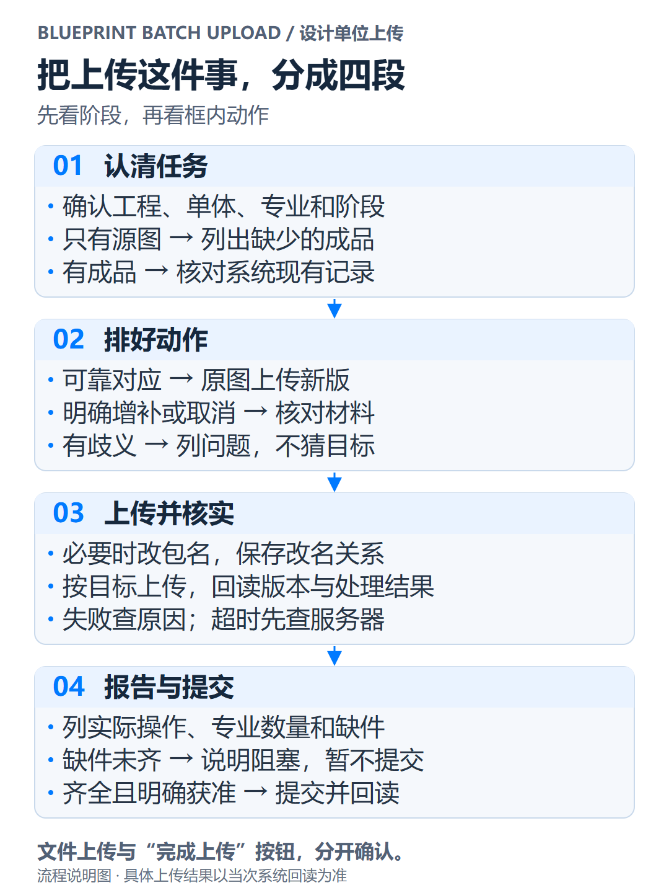
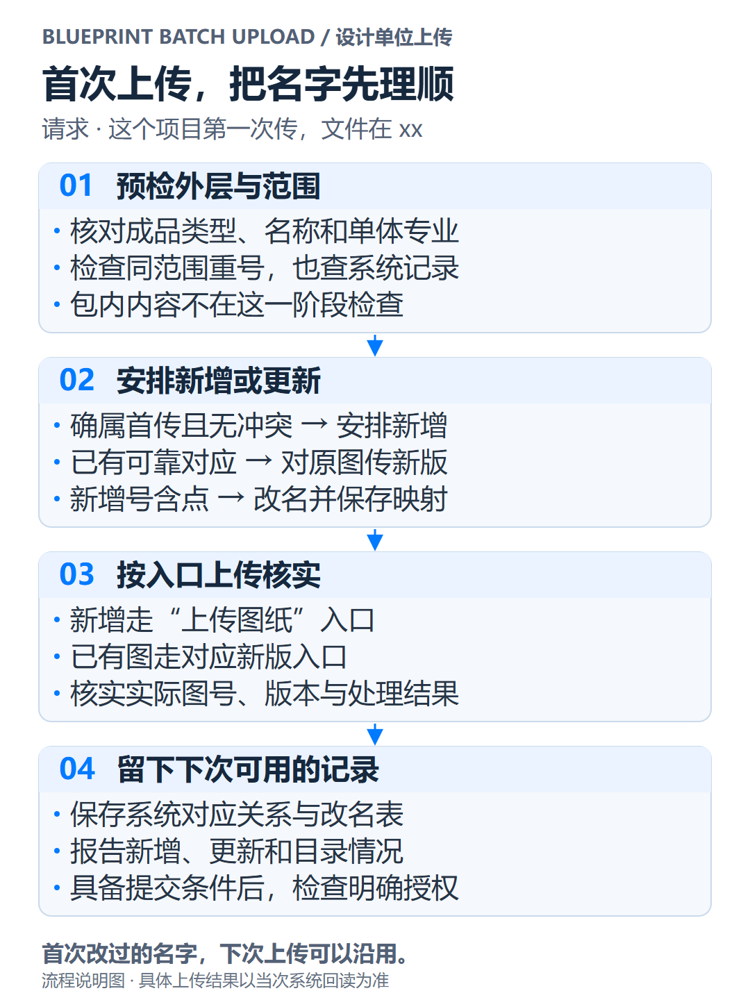
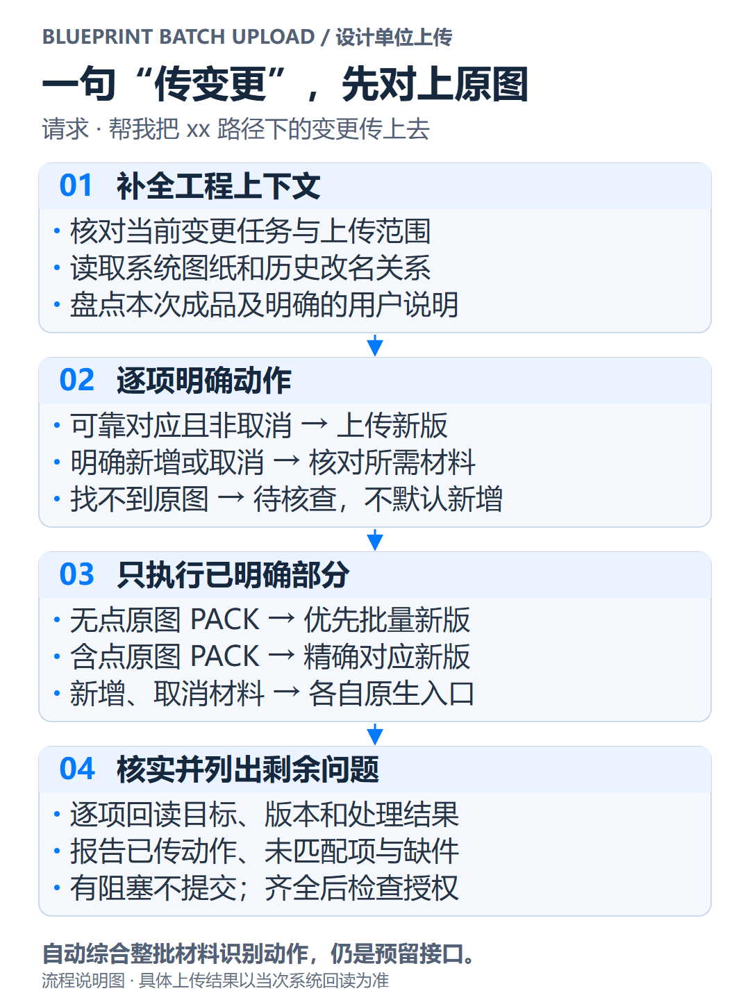
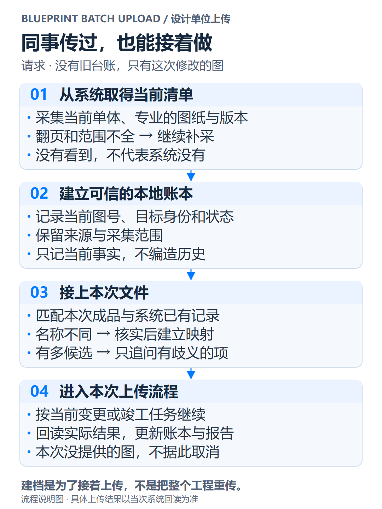
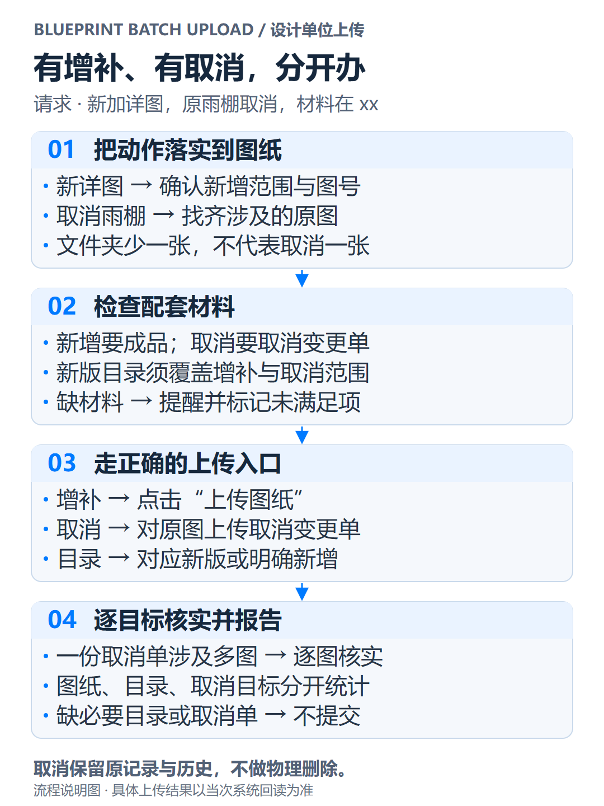
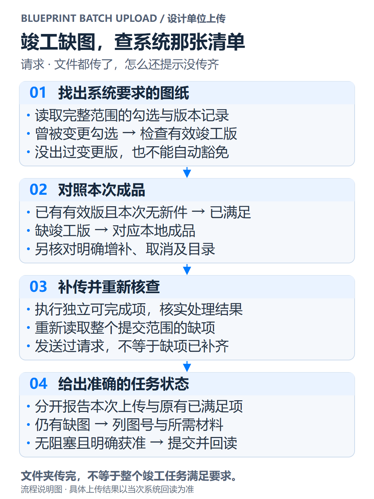
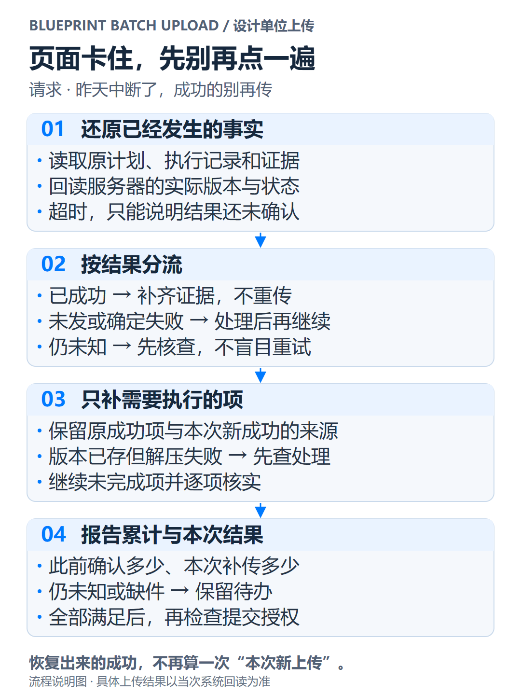
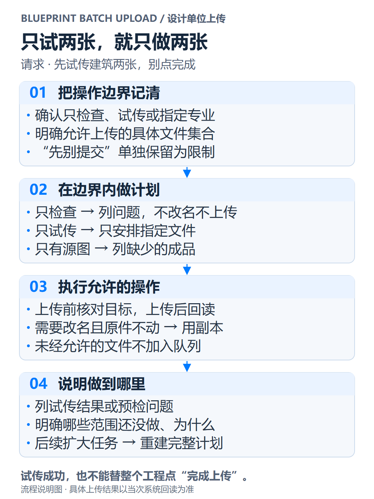
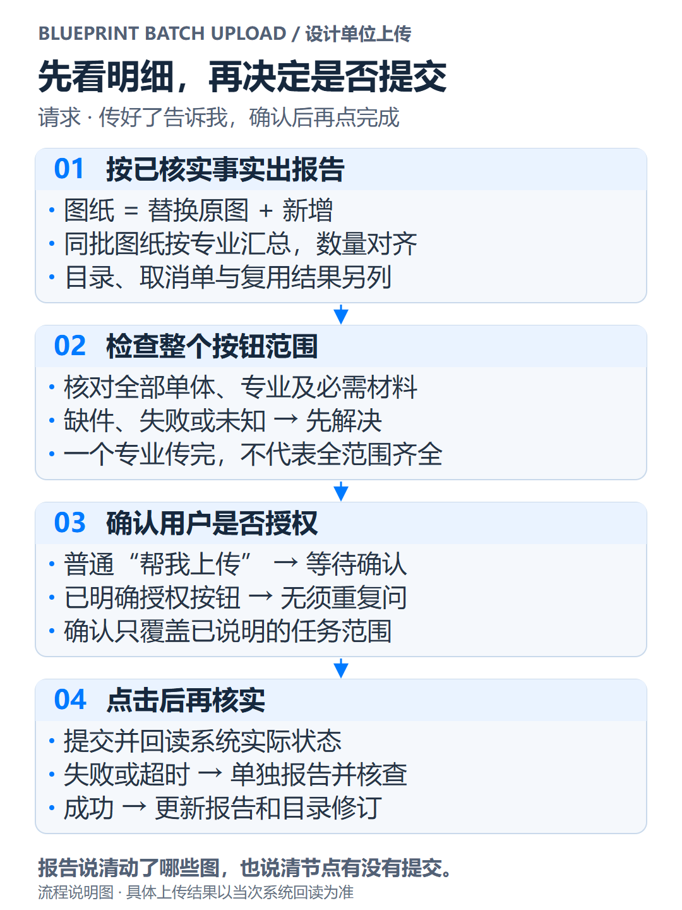

# 图都画完了，怎么还在跟“上传”较劲？

两张图，`J-1.01 首层平面图`、`J-1.02 二层平面图`，准备上传。

系统说，图号重复。

仔细一看，它把两张图的图号都认成了 `J-1`，剩下的 `.01`、`.02` 顺手塞进图名。首层、二层，在一个点号面前合并同类项了。

改完名字，传完文件，终于可以收工？点到竣工那一步，又提示还有图没传。

“这张根本没改过啊。”

但它曾在发起变更时被勾选。你记着“改过哪些图”，系统记着“勾过哪些图”。各自都很认真，就是对不上账。

还有一种更磨人。页面卡着不动，你不知道该等、该刷新，还是再点一次。手已经放在鼠标上，脑子里只有一句话——千万别又多出一个版本。

**blueprint-batch-upload 想接过的，就是这些找图、对号、改包名、传新版、追结果的重复工作。**

它面向设计单位，处理初次上传、变更上传和竣工图上传。你给工程、成品路径和要求，它在授权范围内执行，最后交代清楚动了哪些图、缺什么，以及有没有点击“完成上传”。

这里的点号拆分是用户提供的说明性例子；竣工勾选规则来自原技能的实测经验。本文针对已适配的 JGTGL 工作流，不把这些表现泛化到所有地区的审图系统。下文数字均为说明示例。

## 先看全程，上传分成四段

**认清任务 → 排好动作 → 上传并核实 → 报告与提交。**

认清任务，解决“文件夹属于哪个工程、单体、专业”；排好动作，解决“对原图传新版，还是明确增补、取消”；上传并核实，解决“文件到了没有，版本和解压结果对不对”；报告与提交，解决“具体做了什么，现在能不能结束上传节点”。

每张图都按阶段分组。先扫四个框的标题，就能看完大体流程；需要细节，再看框内的判断和动作。

## 01 第一次上传，先把点号这个坑绕开

> “帮我把这个工程的图纸上传到审图系统，文件在 xx，这个项目第一次传。”

第一次传，最适合把以后要反复用的名字处理好。否则这次手动改一遍，下次设计院发来的文件又恢复原名，还得重新对。

技能按四段处理。**预检外层与范围**，检查成品类型、命名和同范围重号，也查系统是否已经有同事传过的记录。**安排新增或更新**，真正首传的走新增；已有可靠对应的走新版。新增图号含点时，改成无冲突的上传号，并记住原名和新名的关系。

**按入口上传核实**，确认系统实际生成的图号、记录和版本，PACK 还要看处理结果。**留下下次可用的记录**，保存对应关系和改名表，再报告数量与目录情况。

这里直接改成品外层名字，默认不打开包、不检查图签，也不声称包内内容已经同步改好。

你拿到的可以是这样一份结果——“成功新增 42 张图纸，建筑 30 张、给排水 12 张；另上传目录 2 份，外层改名 5 项，明细如下。尚未点击完成上传，等待确认。”初次缺目录会提醒，是否阻塞还要按实际节点要求判断。

## 02 “帮我传变更”，不用先替技能做一遍分类

> “帮我把这个工程的变更图上传到审图系统上，路径在 xx。”

这才像真实委托。很少有人会先整理一份带系统标识、动作字段的技术清单，再请工具帮忙。

技能先**补全工程上下文**，读当前变更任务、系统图纸和历史改名关系。接着**逐项明确动作**，可靠对应原图、又没有取消说明的，安排新版；明确新增或取消的，核对目标和配套材料。

找不到原图怎么办？先列候选和问题。**未匹配不等于新增，本次没提供也不等于取消。**目前综合整批材料自动判断全部动作的能力仍是预留接口，不能把“给我一个文件夹”宣传成无条件全自动分类。

然后**执行已明确部分**。已有原图的 PACK 新版，无点图号优先批量，含点图号精确对应原记录；新增和取消材料走各自原生入口。最后**核实并列剩余问题**，让用户只处理真正有歧义的几项。

例如 15 个文件中，12 个可以可靠对应，3 个找不到目标，就继续不受影响的明确工作，报告“12 张原图新版已核实，另 3 项待核查”。不会把全部 15 项退回来让人重新确认，也不会擅自把那 3 项新建进系统。

## 03 项目是同事传的，台账没交接

> “这个项目之前是同事上传的，我只有这次修改的图。没有旧清单，能接着传吗？”

能从系统现状开始接手。没必要为了传这次修改，把几年前的本地文件都找回来。

第一段，**从系统取得当前清单**。单体、专业、分页和版本都要看全，不能把“这一页没看到”当成“系统不存在”。第二段，**建立可信的本地账本**，记下当前身份、状态和来源，不编造历史上传过程。

第三段，**接上本次文件**，核实名称差异，建立必要的改名映射；只有多候选或依据不足的项才需要进一步说明。第四段，**进入本次上传流程**，按当前变更或竣工任务继续，回读实际结果并更新账本。

这份账本是以后对应图纸的工作记录，不能替代设计单位的正式图纸目录。建档也不是重传整个项目，本次没有提供的图纸，不因此被取消。

## 04 新增两张、取消一张，别都往“上传新版”里塞

> “这次新加了两张详图，原来的雨棚取消了，材料都在 xx。”

“取消”很容易让人想到删除。可这里需要留下取消依据和历史，手快点一下删除，反倒把事情做错了。

技能先**把动作落实到图纸**，明确新详图的范围，也找齐取消雨棚涉及的原图。再**检查配套材料**，新增要有成品，取消要有取消变更单，新版正式目录要覆盖这些变化。

之后**走正确的上传入口**，增补点击“上传图纸”，取消对原记录上传取消变更单，目录对应上传新版或明确新增。最后**逐目标核实并报告**，一份取消单涉及几张图，就逐张核实关联结果。

缺新版目录或取消单时，技能会说明缺什么，独立可做的明确项可以继续；必要材料没补齐，不提交节点。报告也分开写正常图纸、目录、取消单和关联目标，不用一句“处理了 7 个文件”糊过去。

## 05 竣工图传完了，系统还说缺图

> “竣工图在 xx，帮我传。上次一直提示还有变更图没传，我找不到缺哪张。”

这时要查的是系统的必传清单。按原技能已验证的经验，只要曾在发起变更时被勾选，即使后来没改、没出过变更版，也需要满足竣工新版要求。

技能分四段。**找出系统要求的图纸**，检查完整范围里的勾选和有效竣工版本。**对照本次成品**，把缺项逐张对应到本地文件，同时核对明确增补、取消和目录材料。

**补传并重新核查**，执行独立可完成项，再读整个提交范围的缺项；请求发出去不能直接划掉待办。最后**给出准确的任务状态**，本次上传多少、系统原有已满足多少、仍缺哪些成品，分别列明。

例如“本次上传 20 张，原有已满足 70 张，仍缺 10 张的竣工成品”。那 70 张不冒充本次劳动成果，那 10 张也不能因为文件夹已经清空就消失。

## 06 昨天传到一半卡了，今天从哪继续

> “昨天中断了，帮我继续，已经成功的别再传。”

页面没回话，不代表服务器没干活。这时候最不需要的，就是再来一次全选上传。

技能先**还原已经发生的事实**，读原计划、执行记录，再查服务器实际版本。然后**按结果分流**，已成功的补证据、不重传；未发送或确定失败的，处理原因再继续；仍未知的，先核查。

第三段是**只补需要执行的项**。版本已保存但 PACK 解压失败，要先看处理结果，不能连续制造新版本。第四段是**报告累计与本次结果**，让恢复确认和本次新上传各归各位。

“此前确认成功 35 项，本次补传 15 项，累计 50 项已满足。”这样才叫接着做。旧回执没标明执行来源的，单列说明，不猜成“本次上传”。

## 07 先试两张，别顺手把整批提交了

> “先试传建筑专业的两张，给排水还没定，别点完成。”

这句话里，文件范围、专业范围、提交限制都有了。技能需要把它们一直带到执行结束。

先**记清操作边界**，明确允许处理的文件；再**在边界内做计划**。只检查，就列问题，不改名、不上传；只试传，就只安排指定文件；只有源 CAD，就列缺少的成品，前置拆分和打包仍交给后续独立技能。

随后**执行允许的操作**并回读结果。如果用户要求原文件不动而上传需要改名，使用明确的上传副本。最后**说明做到哪里**，写清试了哪些图、哪些范围没做，以及节点未提交。

后续决定扩成完整任务，再按新范围做完整计划。两张试传成功，不等于整个工程可以点“完成上传”。

## 08 “传好了”之后，还应该有一份看得懂的交代

> “传好了告诉我具体做了什么，等我确认再点完成。”

“全部处理完成”看着省心，却没法核对。新增了几张，哪些原图传了新版，目录补了没有？这些都应该直接说出来。

第一段，**按已核实事实出报告**。正常图纸按替换原图、增补分类，同一批再按专业统计；目录、取消材料、复用结果另列。“替换原图”指在原记录上增加新版，历史仍保留。

第二段，**检查整个按钮范围**。一个专业传好了，不代表按钮覆盖的所有单体、专业都齐全。第三段，**确认用户是否授权**。普通“帮我上传”不会自动授权点击“完成上传”；已经明确说过“核验无误后直接点”，就不反复问。

第四段，**点击后再核实**。成功要回读实际状态；提交失败或结果未知，就单独报告，并保留已经核实的文件上传事实。

一份有用的报告可以这样写。

> 本次成功上传 6 张图纸，其中替换原图 4 张、新增 2 张；建筑专业 4 张、给排水专业 2 张。失败 0，待核查 0。
>
> 另上传取消变更单 1 份，成功关联 1 张原图。原记录及历史保留。逐项明细见下方。
>
> 提示：目录未更新，建议提供覆盖本次增补、取消范围的新版目录。补齐前不能提交本次上传节点，尚未点击“完成上传”。

明细会写到具体图号、图名、原文件和上传名、单体专业、实际版本、结果与证据。跨专业汇总也基于各专业实际记录，不把单专业的数量换个大标题就当作整个工程。

## 把委托说到这一步，就可以开始

> “帮我把【工程名】的变更图上传到审图系统，成品在【路径】。这次处理【单体／专业】，新增和取消说明在【位置】。传完先给明细，等我确认再点完成。”

没有增补或取消说明，就如实说还没整理。技能会先做可靠对应和已明确的工作，把需要补充的少数问题列出来。

目前它负责成品上传，能按系统要求直接改外层包名并保留映射。拆图、配对、打包，以及综合整批材料自动识别所有动作，是两个独立的预留方向。原有竣工上传经验已沿用；新增流程与工具有离线验证，尚未完成全部三类流程的新增在线验收。

如果上传结束后，你能直接看到“改了哪几张、加了哪几张、还差什么”，下次变更还能沿用这次的对应关系，这个技能才算帮上了忙。

---

编辑与使用资料：[公众号 HTML 预览](upload-guide/index.html)、[图片与制图源说明](upload-guide/README.md)、[本地工具及报告口径](../references/local-tools.md)、[两个预留接口](reserved-interfaces.md)、[验证与实施记录](implementation.md)。本文为介绍稿，未代为发布到公众号。
